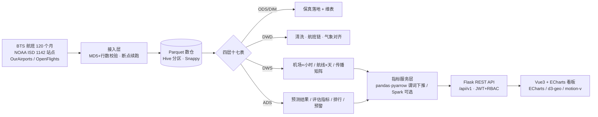

# 航迹 · 基于 Spark 的航班延误预测与航线网络态势可视化系统

> 毕业设计题目：《基于 Spark 的航班延误预测与航线网络态势可视化系统》
> 作者：陈向东（大数据 2302，40516230232）　指导教师：姚杰（副教授）

把 120 个月、约 6300 万条美国国内航班流水（BTS）+ 1142 个气象站点（NOAA ISD）+ 机场航线维表，
加工成一套「可预测、可解释、可下钻」的航班运行态势系统：**数据接入 → 四层数仓 → 指标服务 → REST 接口 → Vue 可视化看板**。

**代码仓库**：<https://github.com/abcaasc/flight-delay-system>　·　**在线演示**：见 [DEPLOY.md](DEPLOY.md) 第 2 节（已内置 `render.yaml`，可在 Render 上蓝图一键部署）
**访问方式**：公开分析页无需登录；本地初始化演示账号后，可用 `admin / admin123` 体验数据管理。

第一次使用可打开[航迹使用指南](USER_GUIDE.md)，按页面操作查看航班、延误原因和预测结果。

---

## 一、功能一览

| 页面 | 能力 | 后端落点 |
| --- | --- | --- |
| 运行总览 | 准点率/延误率/取消率 KPI、环比、日粒度趋势、延误分布 | `stats.overview_*` |
| 航线网络 | 机场节点 + 航线连边（含经纬度）、按延误率着色、地图联动 | `stats.network_graph` |
| 多维分析 | 机场排行、延误原因分解、传播链路桑基图 | `stats.airport_rank` / `delay_reasons` / `propagation` |
| 航班查询 | 多条件筛选、分页、CSV 导出（≤1000 行） | `stats.flights_query` |
| 延误预测 | 单航班延误概率 + 风险等级 + SHAP 归因（LightGBM） | `predict_service.predict_single` |
| 数据管理 | 作业记录、月度数据质量、模型验证报告（需登录） | `system` / `quality` / `ingest` |

---

## 二、系统架构



- **双引擎**：`QUERY_ENGINE=auto|pandas|spark`。两套引擎读同一份 Parquet，切一下就能跑「加速比」实验；无 Spark 环境自动降级 pandas。
- **单容器交付**：前端构建产物由 Flask 直接托管，`/` 出网页、`/api/v1` 出接口，公网演示只需一个容器、一个端口。

---

## 三、技术栈

| 层 | 选型 |
| --- | --- |
| Web | Python 3.12 + Flask 3.1（应用工厂 + 11 个 Blueprint）+ waitress |
| 大数据 | PySpark 3.4（可选，`QUERY_ENGINE=spark`）；ETL 核心按单机 pandas 实现，不能视为全分布式 |
| 数仓 | Parquet + Snappy，Hive 风格分区 `year_month=` / `year=`，四层十七表 |
| 业务库 | MySQL 8.0（SQLAlchemy 2.0 + PyMySQL）；未配置自动回落 SQLite |
| 缓存 | Redis 7（看板 600s / 查询 300s）；不可用自动降级进程内 TTL 缓存 |
| 建模 | LightGBM（`pred_contrib=True` 直接出精确 SHAP），缺依赖时降级为内置线性基线 |
| 前端 | Vue 3.5 + Vite 6 + TypeScript + ECharts 5.6 + d3-geo/us-atlas + motion-v |
| 认证 | JWT(HS256) + PBKDF2 口令哈希 + 四角色 RBAC（guest/ops/analyst/admin） |

---

## 四、快速开始

### 4.1 一键 Docker（最接近线上演示）

```bash
docker build -t flight-delay-system .
docker run --rm -p 7860:7860 flight-delay-system
# 打开 http://127.0.0.1:7860
```

镜像内已带 2024 年瘦身演示数仓（约 30 MB），无需任何外部数据即可打开全部页面。

### 4.2 本地开发

```bash
# 后端
cd backend
python -m venv .venv
.venv\Scripts\activate            # Linux/macOS: source .venv/bin/activate
pip install -r requirements.txt
copy .env.example .env            # 可选：不配也能跑（SQLite + 进程内缓存）
python -m flask --app run.py init-db
python -m flask --app run.py seed-users
python run.py                     # http://127.0.0.1:5000

# 前端（另一个终端）
cd frontend
npm install
npm run dev                       # http://127.0.0.1:5173，/api 自动代理到 5000
```

### 4.3 用本地完整数仓跑

完整数仓（约 12 GB）不进仓库。若本机已有 `backend/data/warehouse`，直接用默认配置即可；
若要重新生成演示数仓：

```bash
cd backend
python scripts/export_demo_data.py --year 2024 --sample-rows 80000
# 产物：backend/data/demo/warehouse（约 30 MB，2024 年 DWS/ADS + 维表 + 抽样明细）
```

---

## 五、演示数据说明

| 层 | 演示集内容 | 约 |
| --- | --- | --- |
| DIM | `dim_airport` / `dim_airline` / `dim_date` / `dim_holiday` 全量 | 0.7 MB |
| DWS | `dws_airport_hourly`、`dws_route_daily` 2024 年 12 个月 | 22 MB |
| ADS | `ads_airport_rank`、`ads_anomaly_alert` 2024 年 12 个月，`ads_model_metric` 全量 | 0.7 MB |
| DWD | `dwd_flight_detail` 2024-12 抽样 8 万行 | 6.3 MB |
| ADS | `ads_delay_pred` 2024-12 抽样 2 万行 | 0.8 MB |
| 模型 | LightGBM 分类模型 + 校准参数 | 2.5 MB |

抽样用固定种子（`--seed 42`）可复现。看板默认月份为 **2024-12**（可用 `VITE_DEFAULT_MONTH` 覆盖）。

---

## 六、目录结构

```
flight-delay-system/
├── Dockerfile                  # 多阶段：Node 构建前端 → Python 运行时
├── DEPLOY.md                   # GitHub + 公网托管完整步骤
├── backend/
│   ├── run.py                  # 入口：dev 用 Flask，prod 用 waitress
│   ├── app/
│   │   ├── config.py           # 唯一配置源（路径/阈值/口径）
│   │   ├── api/                # 11 个 Blueprint
│   │   ├── services/           # 数仓引擎、指标、预测、接入编排
│   │   ├── etl/                # ODS/DIM/DWD/DWS/ADS 作业
│   │   ├── models/             # SQLAlchemy 业务表
│   │   └── utils/              # 响应、参数、JWT/RBAC、日志
│   ├── scripts/                # 巡检 / 冒烟 / 演示数据导出
│   ├── tests/                  # 116 个 pytest 用例
│   ├── docs/                   # 数据字典、接口清单、部署运维、测试用例
│   └── data/
│       ├── demo/warehouse/     # ★ 入库的瘦身演示数仓
│       └── models/             # ★ 入库的模型产物
└── frontend/
    ├── src/                    # 单页应用（6 个分析页）
    └── vite.config.ts          # dev 代理 /api → 后端
```

---

## 七、主要接口

统一响应 `{"code":0,"message":"success","data":{...},"trace_id":"..."}`，完整清单见 `/api/v1/system/endpoints`（由 `url_map` 自动生成）。

| 分组 | 接口 |
| --- | --- |
| 看板 | `GET /api/v1/overview`、`/overview/kpi`、`/overview/trend`、`/overview/distribution`、`/overview/reasons` |
| 网络 | `GET /api/v1/network`、`/network/heatmap`、`/airport/rank`、`/airport/{iata}` |
| 查询 | `GET /api/v1/flights`、`/flights/{flight_sk}`、`/flights/export` |
| 预测 | `POST /api/v1/predict`、`/predict/high-risk`、`/predict/airport`、`/explain/{flight_sk}`、`/explain/global` |
| 认证 | `POST /api/v1/auth/login` |
| 系统 | `GET /api/v1/system/health`、`/system/freshness`、`/system/endpoints` |

示例：

```bash
curl "http://127.0.0.1:7860/api/v1/overview?date_from=2024-12-01&date_to=2024-12-31"

curl -X POST http://127.0.0.1:7860/api/v1/predict \
  -H "Content-Type: application/json" \
  -d '{"origin":"ATL","dest":"LAX","airline":"DL","flight_date":"2024-12-20","crs_dep_time":"0830","top_k":4}'
```

---

## 八、部署到公网

已有仓库：<https://github.com/abcaasc/flight-delay-system>

最省事的一条路（约 3 分钟，无需服务器）：

1. 打开 <https://render.com>，用 GitHub 账号登录；
2. **New + → Blueprint** → 选 `abcaasc/flight-delay-system` → **Apply**（`render.yaml` 已写好，无需手填任何配置）；
3. 等首次构建完成（约 5~8 分钟），得到形如 `https://flight-delay-system-xxxx.onrender.com` 的地址。

免费档 512 MB 内存、闲置 15 分钟休眠，答辩前先访问一次预热（冷启动约 30~60 秒）即可。
Hugging Face Spaces（16 GB 内存、不休眠更久）与自有服务器的步骤见 **[DEPLOY.md](DEPLOY.md)**。

---

## 九、已知限制

1. **PySpark 与 JDK**：PySpark 3.4 只支持 JDK 8/11/17；JDK 21 需切回 17 再用 `QUERY_ENGINE=spark`。
2. **气象站点缺失**：并非每个机场每年都有 ISD 站点文件，缺失机场在 DWD 标 `weather_available=0`，不做全局均值填充。
3. **中国域只有聚合粒度**：STPN 为机场×30 分钟，仅支持机场/时段级跨域对照，不支持中国单航班预测。
4. **单机并发控制**：作业锁是进程内锁，多 worker 部署需换 Redis 锁；本项目按答辩单机场景实现。
5. **演示数据是抽样**：公网演示用 2024 年预聚合 + 抽样明细，绝对数值与全量数仓有差异，趋势与分布一致。

---

## 十、数据来源与许可

| 数据源 | 许可 | 引用要求 |
| --- | --- | --- |
| BTS On-Time Performance | 美国政府公开数据 | 注明来源与下载日期 |
| NOAA NCEI ISD | 公开数据 | 注明站点与时间范围 |
| OurAirports | Public Domain | 建议注明来源 |
| OpenFlights | ODbL | **需署名** |
| STPN（IEEE DataPort） | 数据集页面许可 | 引用 DOI `10.21227/4e59-r355` |
| US Weather Events | Kaggle 公开数据集 | 注明来源 |
